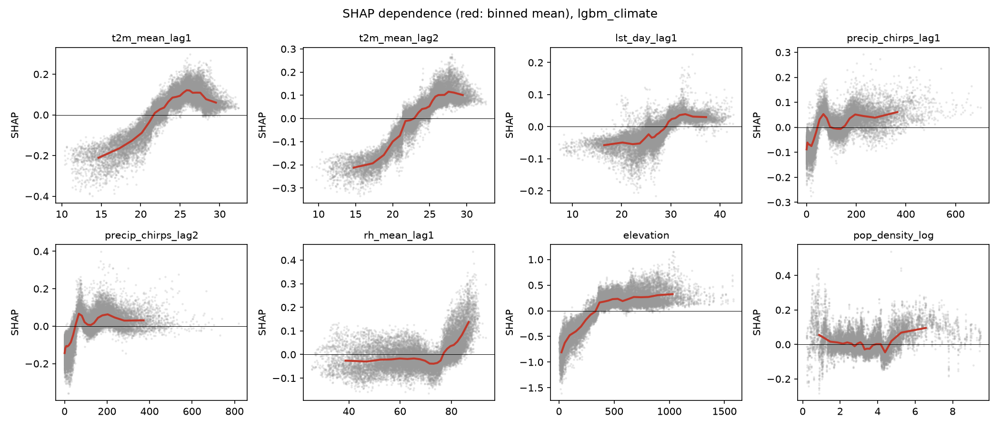
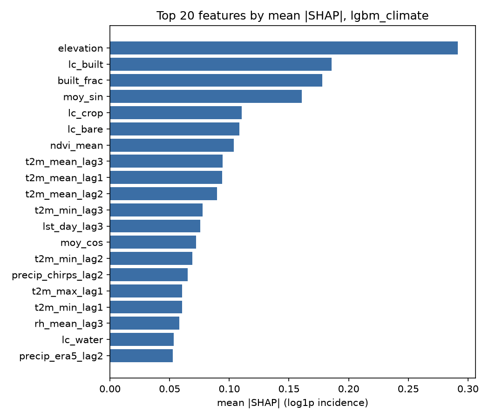

# Dengue risk mapping that is tested on places it has never seen

Monthly dengue risk from satellite climate, land and population data, trained
on Brazil's open weekly municipal case data, validated by holding out whole
regions, and transferred to India where only state-year case counts exist.

> **Research prototype.** The map shows modeled climate and environment based
> relative risk. It is validated against reported cases only for Brazilian
> municipalities and Indian state-years. It is not a case forecast.

**Live map:** https://dengue-risk-map.onrender.com &nbsp;|&nbsp; **API example:** [`/risk?region_id=BR-3304557&month=2025-03`](https://dengue-risk-map.onrender.com/risk?region_id=BR-3304557&month=2025-03) (free tier: first load after idle can take about a minute)

## Question

Can a model built from satellite, climate and population data predict dengue
incidence, and does it still work in a region it was not trained on?

## Data (all public, details and licenses in [docs/DATA_SOURCES.md](docs/DATA_SOURCES.md))

| Role | Source |
|---|---|
| Brazil labels | InfoDengue weekly notified cases, 5,570 municipalities, 2014 to 2025 |
| India labels | OpenDengue V1.3 state-year cases (from NCVBDC), 1997 to 2024 |
| Climate (monthly, lags 1 to 3) | ERA5-Land temperature, humidity, rainfall; CHIRPS rainfall; MODIS land surface temperature |
| Static | GHSL population and built surface, JRC surface water, MODIS NDVI, VIIRS night lights, SRTM elevation, ESA WorldCover |
| Boundaries | IBGE 2022 municipalities; DataMeet India states and Census 2011 districts (Survey of India external boundary) |

All Earth Engine extraction is in [src/dengue/ingest/gee_extract.py](src/dengue/ingest/gee_extract.py).

## Method

- **Unit:** municipality by month (Brazil). Weekly counts are assigned to the
  month of each epi week's Wednesday and scaled to a 4.345-week month.
- **Target:** `log1p(incidence per 100,000)`; alert target: month above the
  municipality's own 75th percentile (thresholds from training years only).
- **Features:** climate at lags 1, 2, 3 months; month of year (sine, cosine);
  static land and population covariates. A prediction for month `t` only uses
  data up to `t - 1` (tested in [tests/test_leakage.py](tests/test_leakage.py)).
- **Models:** seasonal climatology and last-year baselines; LightGBM without
  past cases (`lgbm_climate`, deployed) and with past cases (`lgbm_ar`,
  lags 1, 2, 3, 12); 3 seeds each.
- **Uncertainty:** LightGBM 5% and 95% quantile models, conformalized (CQR) on
  a held-out calibration year.
- **Validation:** temporal hold-out; spatial blocked CV holding out each of
  Brazil's 5 macro-regions (blocked in space and time); Brazil to India
  transfer by state-year rank. 95% CIs from a municipality cluster bootstrap.
- **Explainability:** SHAP (TreeExplainer), with biological sanity checks.
- **Tracking:** every run logged to MLflow (`mlruns/`) with config and git hash.

## Results

All numbers below are produced by the pipeline and rendered by
`python scripts/make_tables.py` into [results/tables.md](results/tables.md),
which has every table in full. Metrics are on `log1p(monthly incidence per
100k)`; brackets are 95% municipality cluster bootstrap CIs (1,000
resamples); LightGBM rows are the mean of 3 seeds (standard deviation of MAE across
seeds at most 0.001).

### Headline findings

1. **Climate explains the season, not the epidemic year.** On 2023 to 2025
   the climate-only model barely beats each municipality's own seasonal
   average (skill 0.012). Those years were far more intense than training
   (mean log incidence 2.23, 3.27, 2.60 vs 0.98 to 2.15 before), and climate
   does not see immunity or serotype shifts.
2. **Past cases carry most of the signal.** Adding lagged incidence lifts
   skill to 0.660, as the brief warned: a strong score does not mean the model
   learned climate.
3. **Climate helps where history is missing.** Holding out whole regions, the
   model beats the history-free alternative (pooled climatology) in 4 of 5
   regions, but not a place's own history.
4. **Spatial transfer to India failed; seasonal timing transferred.** State
   ranks were worse than population density alone; the national monthly
   curve tracked reported cases (Spearman 0.855).
5. **SHAP shows both biology and confounding.** Temperature effect peaks at
   25.8 to 27.5 deg C and declines above, as expected. Elevation, the top
   feature, acts as a Brazilian geography proxy and drove the worst India
   errors.

### Temporal hold-out (train 2015 to 2021, calibrate 2022, test 2023 to 2025; n = 200,520 municipality-months)

| Model | MAE | Skill vs climatology | Spearman | Alert F1 | Alert AUC-PR |
|---|---|---|---|---|---|
| Seasonal climatology (own history) | 1.758 [1.736, 1.781] | 0 | 0.576 | 0.415 | 0.515 |
| Same month last year | 1.637 [1.621, 1.656] | -0.040 [-0.060, -0.021] | 0.540 | 0.612 | 0.627 |
| **LightGBM, climate only** | 1.821 [1.799, 1.843] | 0.012 [0.006, 0.017] | 0.602 | 0.396 | 0.520 |
| LightGBM + past cases | 0.984 [0.974, 0.995] | 0.660 [0.654, 0.667] | 0.821 | 0.679 | 0.806 |

By year, the climate model's skill was -0.080 (2023), 0.086 (2024, the
record epidemic) and -0.037 (2025). 90% conformal intervals covered 0.831
(climate) and 0.878 (with past cases): below nominal, because calibration
year 2022 is not exchangeable with the shifted test years (coverage 0.886,
0.768, 0.839 by year for the climate model).

**Does climate add anything beyond a place's own history?**
([ablation](results/ablation_climate_value.csv)) LightGBM given the local
climatology value: + static covariates, skill 0.000; + lagged climate, skill
-0.008 [-0.010, -0.006]. With local history in hand, climate is redundant on
these years.

### Spatial blocked CV (train on 4 macro-regions in 2015 to 2021, test the 5th in 2023 to 2025)

| Held-out region | Skill vs pooled climatology (no local history) | Skill vs region's own history | 90% interval coverage |
|---|---|---|---|
| Center-West | 0.357 [0.336, 0.377] | -0.184 | 0.881 |
| North | -0.046 [-0.088, -0.005] | -0.235 | 0.861 |
| Northeast | 0.041 [0.023, 0.059] | -0.010 | 0.978 |
| South | 0.085 [0.062, 0.107] | 0.101 | 0.751 |
| Southeast | 0.287 [0.268, 0.304] | -0.084 | 0.741 |

A model that looks fine in time can still fail in a new place (North) and its
uncertainty does not transfer reliably (coverage 0.74 to 0.98).

### Brazil to India transfer (35 states, 2015 to 2024, OpenDengue / NCVBDC)

| Ranking of states by | Mean Spearman (min to max over years) | Mean top-5 overlap |
|---|---|---|
| **Brazil-trained climate model** | 0.146 (-0.065 to 0.310) | 1.6 |
| Population density only | 0.258 (0.064 to 0.477) | 2.7 |
| Last year's reported incidence | 0.695 (0.562 to 0.824) | 3.3 |
| Model without elevation (post-hoc diagnostic) | 0.199 (-0.090 to 0.407) | 1.9 |

Every yearly 95% CI for the model includes 0. Seasonality did transfer: for
2024 the predicted national monthly curve had Spearman 0.855 with reported
cases (predicted peak August, reported peak October). Why ranks failed:
Uttarakhand was ranked highest almost entirely through elevation (mean
district elevation 1,813 m vs Brazil's maximum of 1,580 m), and 24.7% of India
district-months (442 of 641 districts) have at least one input outside the
Brazil training range, mostly maximum temperature and elevation
([india_out_of_range.csv](results/india_out_of_range.csv)). The map flags
these predictions. Dropping elevation (chosen after seeing these results, so
a diagnostic only) raised the mean Spearman to 0.199 but lowered Brazil
temporal skill to -0.014.

### Explainability (SHAP, climate-only model)



- Temperature (mean, lags 1 to 3): SHAP rises with temperature and peaks at
  25.8, 27.5 and 26.2 deg C, then falls, consistent with the known optimum of
  about 26 to 29 deg C.
- Rainfall and humidity (lags 1 to 3): positive (Spearman between value and
  SHAP 0.65 to 0.69 for CHIRPS rain, 0.53 to 0.89 for humidity); very dry
  months lower risk.
- Mean temperature is the most important climate variable at every lag
  ([lag table](results/shap_lag_importance_lgbm_climate.csv)).
- Elevation is the top feature overall but with a positive sign, the opposite
  of simple altitude biology: Brazil's high-burden areas sit on the 400 to
  1,000 m central plateau. This is confounding, not biology.



### What I would not claim

- That the map forecasts case counts. It is relative, climate-driven risk.
- Anything at Indian district level: there is no public district case data.
- That intervals have their nominal 90% coverage in new years or regions.

## Reproduce

```bash
python -m venv .venv && .venv/bin/pip install -e ".[dev]"   # Windows: .venv\Scripts\pip
earthengine authenticate && echo "EE_PROJECT=<your-ee-project>" > .env
python -m dengue.cli all          # or: make all
python scripts/make_tables.py     # renders results/tables.md
uvicorn app.api.main:app --port 8000   # map at http://localhost:8000
```

Stages (each cached, rerun from any point): `boundaries, cases, gee_brazil,
features, india, temporal, spatial, explain, final, transfer, export`.
Raw pulls are cached under `data/raw/` with URL and UTC pull time in
`data/raw/manifest.jsonl`. Dependencies are pinned in `pyproject.toml` and
`requirements.lock`. Full run on a laptop: about 1 hour of downloads
(InfoDengue is rate limited politely) plus about 1.5 hours of model fitting.

## Repository

```
configs/default.yaml   every setting (years, lags, splits, model params, seeds)
src/dengue/ingest      InfoDengue, OpenDengue, boundaries, Earth Engine
src/dengue/features    labels, lags, seasonality
src/dengue/models      baselines, LightGBM, conformal, deployment model
src/dengue/validation  splits (with leakage checks), metrics, bootstrap, transfer
src/dengue/explain     SHAP and sanity checks
app/                   FastAPI backend, Leaflet map, Dockerfile, exported data
.github/workflows      CI (ruff, pytest) and the monthly data refresh
docs/                  data sources, model card
report/                technical report
```

## Interview story

"I reused my thesis geospatial pipeline to build monthly dengue risk
predictions from climate, land and population data. I trained on Brazil's open
weekly municipal data, validated by holding out whole regions to test transfer
to unseen places, and then tested whether the model ranks Indian states
correctly against reported cases. I show uncertainty intervals and the drivers
behind each prediction, and the map updates monthly automatically. The main
lesson: a model that looks strong in random splits can degrade in new regions,
so spatial validation is essential before any public-health use."

What the data actually showed, which I lead with in interviews: the
climate-only model is close to useless where a place already has case
history, useful as a prior for regions without it (4 of 5 held-out Brazilian
regions), and it failed to rank Indian states even though it got India's
season right. SHAP made the failure diagnosable: a Brazilian geography proxy
(elevation) was being applied to the Himalaya, and the map now flags inputs
outside the training range instead of hiding them.

## License and attribution

Code: MIT. Data remain under their own licenses (see
[docs/DATA_SOURCES.md](docs/DATA_SOURCES.md)). Contains modified Copernicus
Climate Change Service information. India boundaries by the DataMeet India
community.
